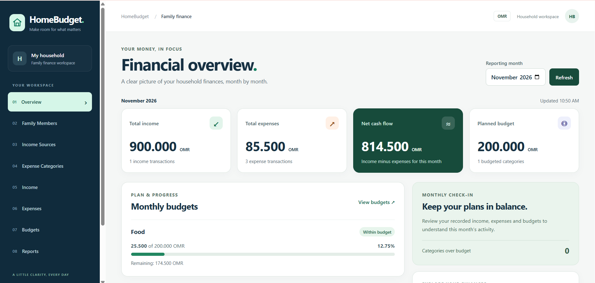
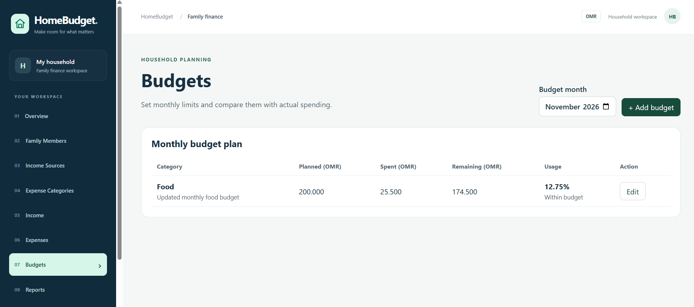
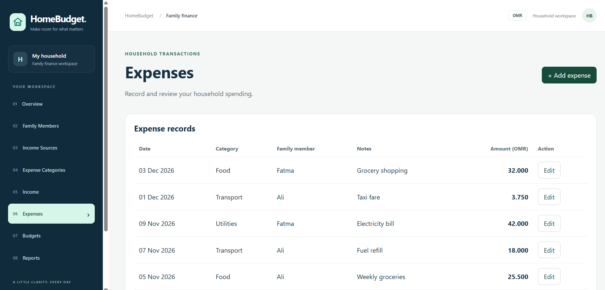
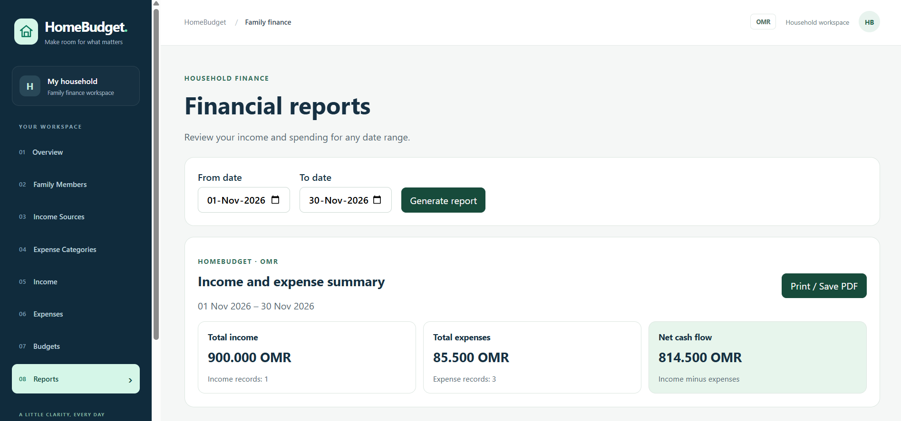

# 🏠 HomeBudget
### Family Budget Management Application

HomeBudget is a full-stack web application designed to help families manage household finances through income tracking, expense management, monthly budgets, and financial reports.

## ✨ Features

- Family member management
- Income tracking by family member and income source
- Expense tracking with categories
- Monthly budget planning
- Financial summaries and reports
- Dashboard for household financial overview

## 🛠️ Tech Stack

**Frontend**
- Angular
- TypeScript
- HTML & CSS

**Backend**
- C#
- ASP.NET Core Web API (.NET 8)
- Entity Framework Core

**Database**
- Microsoft SQL Server Express

**Development Tools**
- Visual Studio Code
- Swagger / OpenAPI
- GitHub

## 🏗️ Project Structure

- `HomeBudget-API/` — Backend API
- `homebudget-client/` — Angular frontend
- `HomeBudget.sln` — .NET solution

## 📸 Application Screenshots

Explore the main features of HomeBudget through its application interface.

### 1. Financial Overview — Dashboard

View household income, expenses, net cash flow, and monthly budget progress in one place.

### 2. Monthly Budget Management

Set monthly budgets by expense category, compare planned amounts with actual spending, and monitor remaining balances.

### 3. Household Expense Tracking

Record and manage household expenses by category, family member, date, and amount.

### 4. Financial Reports

Generate financial summaries for selected date ranges, review income and expenses, and print or save reports as PDF.

## 🚀 Getting Started

This project currently runs in a local development environment.

To run it locally, you will need:

- .NET 8 SDK
- Node.js and npm
- Angular CLI
- SQL Server Express
- A configured local database

Detailed installation and configuration instructions will be added after verification.

## 📌 Project Status

Local development and testing.

Online deployment has not yet been implemented.

## 👩‍💻 Developer

**Fatma Al Riyami**

[GitHub Profile](https://github.com/fatma-alriyami)

---

*Building practical software solutions for everyday needs.*
